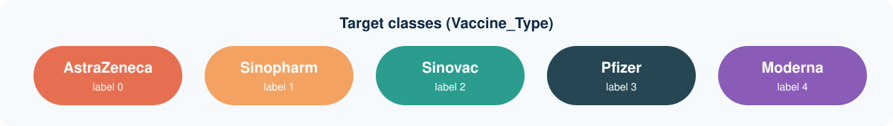
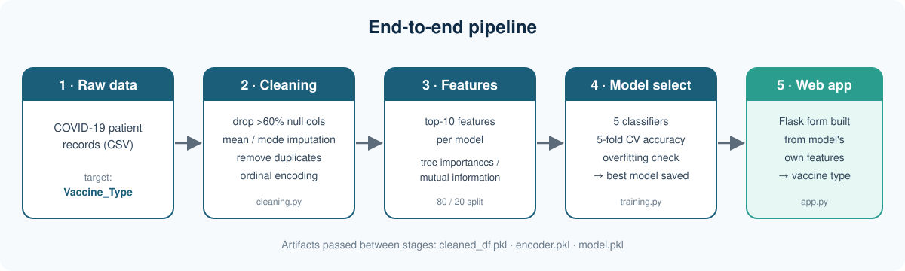
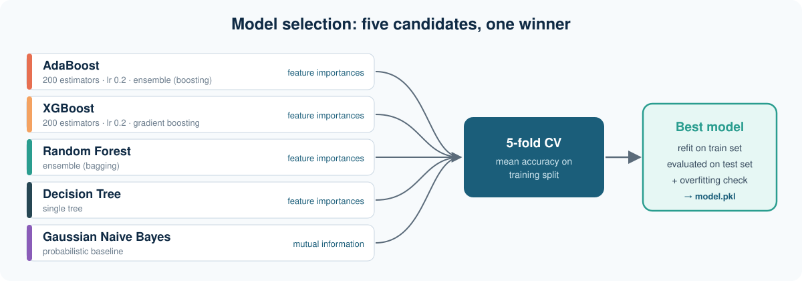

<p align="center">
  
</p>

<p align="center">
  
  
  
  
  
</p>

A machine learning project that predicts which **COVID-19 vaccine type** a patient received from their clinical and demographic records. Five classifiers are trained, the best one is picked by **5-fold cross-validation**, and the winning model is served through a small **Flask** web app.

> [!NOTE]
> This project is under active development.

---

## Table of contents

- [Overview](#overview)
- [Pipeline](#pipeline)
- [Models](#models)
- [Project structure](#project-structure)
- [Getting started](#getting-started)
- [Training outputs](#training-outputs)
- [Tech stack](#tech-stack)
- [Author](#author)

---

## Overview

The task is a **5-class classification problem**. Each record is labelled with one of the following vaccines:

<p align="center">
  
</p>

Instead of relying on a single algorithm, the project compares tree-based, ensemble and probabilistic models. Each model gets its own feature selection, and the model with the highest cross-validation accuracy is chosen.

## Pipeline

<p align="center">
  
</p>

| Stage | Script | What happens |
|---|---|---|
| **Cleaning** | `cleaning.py` | Drops columns with more than 60% missing values and `Date_Reported`. Fills remaining nulls (mean for numeric, mode for categorical), removes duplicates, encodes the label (0–4) and ordinal-encodes categorical features. Saves `cleaned_df.pkl` and `encoder.pkl`. |
| **Feature selection** | `training.py` | 80/20 train–test split. Picks the top 10 features for each model: tree importances for the tree/ensemble models, mutual information for Naive Bayes. |
| **Model selection** | `training.py` | Scores every model with 5-fold cross-validation, refits the best one, checks the train/test accuracy gap for overfitting, and saves `model.pkl`. |
| **Serving** | `app.py` | Builds an input form from the saved model's own feature list (dropdowns for categorical features, number fields for numeric ones) and returns the predicted vaccine type. |

## Models

<p align="center">
  
</p>

| Model | Type | Feature selection |
|---|---|---|
| AdaBoost (200 estimators, lr 0.2) | Boosting ensemble | Feature importances |
| XGBoost (200 estimators, lr 0.2) | Gradient boosting | Feature importances |
| Random Forest | Bagging ensemble | Feature importances |
| Decision Tree | Single tree | Feature importances |
| Gaussian Naive Bayes | Probabilistic | Mutual information (`SelectKBest`, k = 10) |

## Project structure

```
corona_vaccine_prediction/
├── cleaning.py          # data cleaning and encoding → cleaned_df.pkl, encoder.pkl
├── training.py          # feature selection, model comparison, evaluation → model.pkl
├── app.py               # Flask web app for predictions
├── Templates/
│   └── index.html       # input form and result page
├── assets/              # README images
├── requirements.txt
└── BUILD_Info.org       # build environment notes
```

> The dataset and the generated `.pkl` files are not tracked in the repository.

## Getting started

### 1. Clone and install

```bash
git clone https://github.com/Junaid-Ahmed-Rupok/corona_vaccine_prediction.git
cd corona_vaccine_prediction
python -m venv venv
source venv/bin/activate        # Windows: venv\Scripts\activate
pip install -r requirements.txt
```

### 2. Prepare the data

Point the path at the bottom of `cleaning.py` to your copy of the dataset (`unbiased_covid_dataset.csv`), then run:

```bash
python cleaning.py
```

### 3. Train and select the model

```bash
python training.py
```

This prints the cross-validation score of each model, names the best one, and saves it as `model.pkl`.

### 4. Launch the web app

```bash
python app.py
```

Open <http://127.0.0.1:5000>, fill in the patient details and click **Predict**.

## Training outputs

Running `training.py` produces:

- **Cross-validation scores** for all five models, plus the name of the selected model
- **Overfitting check** for every model (flags a train/test accuracy gap above 0.10)
- **Classification report** (precision, recall, F1 per vaccine type) on the test set
- **Confusion matrix** heatmap for the best model
- **Learning curves** (training vs. validation accuracy) for all models
- **Feature importance** bar charts for the tree-based models

## Tech stack

**Language:** Python 3.12  
**ML:** scikit-learn, XGBoost  
**Data:** pandas, NumPy  
**Visualisation:** Matplotlib, Seaborn  
**Serving:** Flask, joblib

## Author

**Sarder Junaid Ahmed**  
GitHub: [@Junaid-Ahmed-Rupok](https://github.com/Junaid-Ahmed-Rupok)
